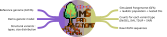

# MSpangenome



MSpangenome is a workflow for simulating pangenome variation graphs from coalescent simulations. A description of the algorithm is available in the [BioRxiv preprint (2026)](https://doi.org/10.64898/2026.06.29.735168) and the [JOBIM poster (2025)](https://lpiat-pages-cfefee.pages-forge.inrae.fr/poster_bims_lucien.pdf).

A selection of graph construction examples illustrating different parameter combinations is available [here](https://mspangenome.example.lucienpiat.fr/) (use the arrows in the top-right corner to navigate through the construction steps as locus mutations are progressively incorporated into the variation graph).

The official MSpangenome repository can be found at the [INRAE forge](https://forge.inrae.fr/pangepop/MSpangepop).\
A GitHub mirror can be found at [INRAE GitHub](https://github.com/inrae/MSpangepop).\
The mirror is particularly useful for users without a Renater account who wish to submit issues.

[[_TOC_]]

## Workflow overview

| Stage | Process | Scripts (dev reference) | smk rules (dev reference) |
|-------|---------|---------|--------|
| **1. Setup** | → Validate FASTA/YAML<br>→ Expand configs<br>→ Create index | `input_index.py`<br>`sample_ranges.py`<br>`recap.py` | setup |
| **2. Msprime Simulation** | → Build demographic model<br>→ Run msprime<br>→ Generate visualizations | `msprime_simulation.py`<br>`visualizer_arg.py`<br>`visualizer_tree.py` | msprime_simulation <br>visualization  |
| **3. Preprocessing** | → Split by locus<br>→ Preorder traverse trees<br>→ Assign SV type, length and position | `coalescent_traversal.py`<br>`draw_variants.py`<br>`split_recombination.py` | coalescent_traversal<br>draw_variants<br>split_recombination |
| **4. Graph Creation** | **Initialize:** Build locus ancestral graphs<br>**Mutate:** Apply variants using the MSpangenome library<br>**Save:** Assign IDs → VG unchop each locus → Group loci into subgraph GFAs (100 loci per file by default) | `graph_creation.py`<br>`graph_classes.py`<br>`graph_utils.py`<br>`matrix.py` | graph_creation |
| **5. Merge** | Concatenate the subgraph GFAs → VG unchop the junctions between groups | `merge_subgraphs.py` | gfa_merge |

## Citation

If you use MSpangenome in your research, please cite:

Piat, L., Denni, S., Dubois, S., Linard, B., & Duvaux, L. (2026). Simulating population pangenomes under coalescent demographic models with MSpangenome. *bioRxiv*, 2026.06.29.735168 (preprint). https://doi.org/10.64898/2026.06.29.735168

Scripts to run the paper's analyses can be found [here](https://github.com/Lucien-Piat/MSpangenome_methods).

## Guides and references

|  |  |
|-------|-------------|
| **[Master Configuration](doc/configuration_master.md)** | How to set up configuration files and parameters |
| **[Demographic model](doc/configuration_model.md)** | Adapt or create a demographic model |
| **[Output Files](doc/output_files.md)** | Description of generated results and outputs |
| **[Mutation log](doc/mutation_log.md)** | Format of the per chromosome registry of applied mutations |
| **[Advanced Topics](doc/go_even_deeper.md)** | [Advanced flowchart](doc/workflow_flowchart.png) & in-depth information for power users |

---
## Prerequisites

The workflow requires Conda and Apptainer. The following versions have been tested successfully:

- Conda 25.7.0 (Miniforge is recommended)
- Apptainer 1.5.4

### On an HPC cluster

These prerequisites may already be available as environment modules. Check with your sysadmin or consult your cluster documentation.

### On a Linux PC

#### Install Conda

We recommend using Miniforge, a lightweight Conda distribution based on the community-maintained conda-forge channel.

If available, install Miniforge through your Linux distribution's package manager.

If Miniforge is not available or is outdated in your distribution's repositories, follow the installation instructions provided in the official Miniforge documentation:

https://github.com/conda-forge/miniforge

Once installed, check that Conda is available:
`conda --version`

#### Install Apptainer

Install Apptainer using your Linux distribution's package manager, if available. Installation instructions for different Linux distributions are provided in the official Apptainer 1.5 documentation:

https://apptainer.org/docs/admin/1.5/installation.html

Once installed, check that it is available:
`apptainer --version`

### On a macOS or Windows PC

This workflow requires a Linux environment. On macOS, use a supported Linux virtual machine (e.g. [Lima](https://lima-vm.io/)). On Windows, use [Windows Subsystem for Linux (WSL)](https://learn.microsoft.com/en-us/windows/wsl/).

Install Conda and Apptainer inside the Linux environment, following the instructions above.

## How to Use 
### 1. Set up

Clone the Git repository
```bash
git clone https://forge.inrae.fr/pangepop/MSpangepop 
```

- Create an environement for snakemake (from the provided envfile): 
```bash
conda env create -n wf_env -f dependencies/wf_env.yaml
```  

Activate the environment before running the workflow:
```bash
conda activate wf_env
```

### 2. Configure the pipeline for your data

[Three elements](doc/pipe.png) are needed to run the simulation :
- The `masterconfig` -> **[Master Configuration](doc/configuration_master.md)**
- The `demographic_file`  -> **[Demographic model configuration](doc/configuration_model.md)**
- A reference FASTA specified by `fasta_gz` (plain or gzip-compressed). The workflow uses the first `chr_n` contigs in the file; one contig is enough for a small test run.

#### To do a quick test :

Edit the `masterconfig` file in the `.config/` directory with your sample information. (**[Master Configuration](doc/configuration_master.md)**)

```bash
nano .config/masterconfig.yaml
```

Example config:
```yaml
samples:
  test_run:
    model: "simulation_data/Panmictic_Model.json"
    replicates: 1
```
- `model` is the demographic scenario the simulation will run on. You can create your own or tailor the ones in `./simulation_data` (**[Demographic model configuration](doc/configuration_model.md)**)

- **⚠️ Don't want to create your own model?⚠️** 
  - Use the provided `Panmictic_Model.json` - simply edit it to specify your genome (`fasta_gz`), then adjust `mutation_rate` and `recombination_rate` (start with low values).
  - Alternatively, pick a model that has been rigorously reviewed and validated by multiple authors. Such models are available in the PopSim Consortium catalogs: [stdpopsim](https://popsim-consortium.github.io/stdpopsim-docs/stable/index.html) and the [Demes model gallery](https://popsim-consortium.github.io/demes-spec-docs/main/gallery.html).

### 3. Run the workflow 
#### On the cluster

- Activate the [Apptainer](https://apptainer.org/docs/user/latest/) / Singularity module from your cluster

- Run the workflow :
```bash
sbatch mspangenome dry # Check for warnings
sbatch mspangenome run # Then
```
> **Nb :** The Snakemake SLURM executor tries to infer the SLURM account when submitting workflow jobs. If your cluster requires an account and it cannot be inferred, set `slurm_account` under `default-resources` in `.config/snakemake/profiles/slurm/config.yaml`.

> **Nb :** Use the command `squeue --format="%.10i %.9P %.6j %.10k %.8u %.2t %.10M %.6D %.20R" -A $user` to see job **names**

> **Nb :** The working directory is automatically mounted inside the containers. However, files and directories located elsewhere on the host system (e.g. reference genomes or output directories) may not be accessible from within the containers. In such cases, use `--bind` to explicitly mount the required directories; otherwise, workflow rules attempting to access them will fail with a "file not found" error.
>
> For example:
>
> ```bash
> sbatch mspangenome run --bind /work/refs,/scratch/$USER
> ```


#### Locally

Once the [prerequisites](#prerequisites) are installed, run:

```bash
./mspangenome dry # Check for warnings
./mspangenome local-run # Then
```

## Other running options
```text
Usage: mspangenome [COMMAND] [OPTIONS] [SNAKEMAKE_ARGS]

Commands:
  dry           Run in dry-run mode
  run           Run the workflow with SLURM
  local-run     Run the workflow locally (on a single node)
  dag           Generate the directed acyclic graph for the workflow
  rulegraph     Generate the rulegraph for the workflow
  unlock        Unlock the working directory if Snakemake crashed
  touch         Tell Snakemake that all files are up to date (use with caution)

Options:
  -c, --config PATH    Master config file (default: .config/masterconfig.yaml)
  --bind PATHS         Extra paths to mount in containers (comma-separated, repeatable)

Additional arguments:
  SNAKEMAKE_ARGS       Any additional Snakemake arguments (e.g. --until coalescent_traversal)
```

## Authors

- Lucien Piat
- Sukanya Denni
- Siegfried Dubois
- Jean-Marc Frigerio
- Ludovic Duvaux

## Contact

ludovic.duvaux@inrae.fr

## Aknowledgements

- Christophe Klopp
- Claire Lemaitre
- Benjamin Linard
- Camille Marchet
- Jean Monlong
- Networks:
  - AgroDiv pangenome working group
  - Get-A-Pan ([site](https://pangenomes.mathnum.inrae.fr/) and [repo awesome_pangenomes_inrae](https://forge.inrae.fr/get-a-pan/awesome_pangenome_in_inrae))
  - PANANNOT
  - GraPanPhy
